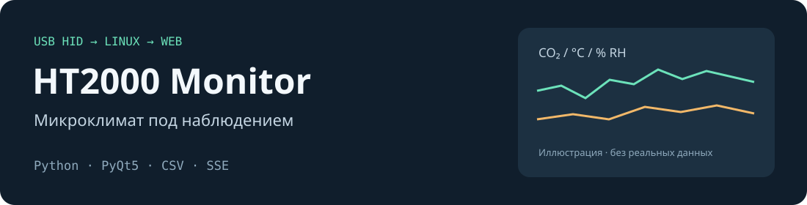

# HT2000 Monitor



**Показания SLAB HT2000 в системном трее Linux и в браузере.**
Приложение читает USB HID-датчик, показывает концентрацию CO₂, температуру
и влажность, сохраняет минутные медианы в CSV и строит графики измерений.

[Лендинг](https://ishmyak.github.io/HT2000/) ·
[Подробное руководство](docs/usage.md) ·
[Сообщить об ошибке](https://github.com/ishmyak/HT2000/issues)

## Возможности

- Одна иконка в трее с крупным значением CO₂ и цветовой индикацией.
- Уведомления при росте CO₂ и индикация потери связи с датчиком.
- Температура, влажность и статусы комфорта в подсказке и веб-интерфейсе.
- Минутные медианы, отдельный CSV на каждый день и пауза записи.
- Веб-дашборд: час, четыре часа, сутки и неделя; SVG-графики и обновление через SSE.
- Светлая/тёмная тема, изменение порядка графиков и просмотр подключённых клиентов.
- Утилита поиска пропусков в истории измерений.

## Оборудование и требования

| Компонент | Требование |
| --- | --- |
| Устройство | SLAB HT2000, USB HID: VID `10c4`, PID `82cd` |
| ОС | Linux с `hidraw`, графической сессией и системным треем |
| Python | Основное окружение проекта — Python 3.11 |
| GUI | PyQt5, устанавливается системным пакетом |
| Чтение устройства, CSV и веб-сервер | Стандартная библиотека Python |

Основное окружение разработки — Astra Linux 1.8 / Fly.
Отдельная проверка на других дистрибутивах и под Wayland не выполнялась.
Windows и macOS не поддерживаются текущим hidraw-backend.
Библиотеки `hid`, `usb`, сервер БД и облачный сервис не требуются.

## Быстрый старт

Установите Python 3 и PyQt5 средствами своего дистрибутива. Для систем
с Debian-пакетами соответствующий пакет называется `python3-pyqt5`:

```bash
sudo apt-get install python3 python3-pyqt5
git clone https://github.com/ishmyak/HT2000.git
cd HT2000
```

Подключите датчик. Для доступа без запуска GUI от root установите правило udev:

```bash
sudo cp 99-ht2000.rules /etc/udev/rules.d/
sudo udevadm control --reload-rules
sudo udevadm trigger
```

При необходимости переподключите датчик. Поставляемое правило использует
`MODE="0666"`: доступ к этому устройству получают все локальные пользователи.
На общей машине настройте более узкие права в соответствии со своей политикой.

Запустите из терминала внутри графической сессии:

```bash
python3 ht2000_monitor.py
```

Кликните по иконке трея, чтобы открыть веб-дашборд. Сервер запускается при
открытии страницы либо через пункт меню «Сервер»; используется первый свободный
порт из `8080–8089`. На этой машине адрес будет `http://127.0.0.1:ПОРТ/`.

## Запуск в фоне

```bash
bash start_ht2000.sh start
bash start_ht2000.sh status
bash start_ht2000.sh restart
bash start_ht2000.sh stop
```

Лог — `monitor.log` рядом с приложением. Скрипт не устанавливает автозапуск
и не настраивает графическую сессию за пользователя.

## Данные и настройки

Данные остаются в каталоге `data/` рядом с программой. Формат CSV:

```text
datetime;co2_ppm;temp_c;rh_percent
```

Файл `ht2000_YYYY-MM-DD.csv` содержит отдельные медианы CO₂, температуры
и влажности за каждую измеренную минуту. При разрыве связи пустые минуты
пропускаются. На штатном выходе сохраняется неполная последняя минута.

Для собственных диапазонов комфорта скопируйте [config.example.json](config.example.json)
в `~/.config/ht2000/config.json` или `config.json` рядом с модулями.
Первым используется файл из домашнего каталога. Это пользовательские ориентиры,
а не подтверждение соответствия санитарным нормативам и не медицинская оценка.

Диагностика истории:

```bash
python3 data_gaps.py --data-dir ./data --hours 24
```

## Доступ по сети

Включённый веб-сервер слушает **все интерфейсы (`0.0.0.0`)**.
В нём нет аутентификации и TLS. Другие участники доступной сети могут
читать показания и графики. Используйте доверенную сеть и ограничивайте
доступ межсетевым экраном; не публикуйте порт напрямую в Интернет.
Подробнее — [SECURITY.md](SECURITY.md).

CSV, логи, локальный `config.json` и внутренние инструкции не входят
в публичную поставку.

## Разработка и проверка

```bash
python3 -m unittest discover -s tests -v
bash -n start_ht2000.sh
```

Тесты не требуют подключённого датчика или GUI. Сетевые тесты поднимают
локальный HTTP-сервер: разрешите локальные сокеты и исключите localhost
из прокси (`NO_PROXY=localhost,127.0.0.1`).

[Как внести изменения](CONTRIBUTING.md) · [Описание протокола](docs/usage.md#протокол-устройства)

Основные модули: `ht2000_reader.py` — устройство, `ht2000_logger.py` — медианы,
`comfort.py` — диапазоны, `ht2000_web.py` — дашборд, `ht2000_monitor.py` — GUI.
`src/ht2000_reader.py` — ранний вариант чтения; текущее приложение использует
корневой `ht2000_reader.py`.

Автор — [Mikhail Yakimuk / ishmyak](https://github.com/ishmyak).
Описание HID-протокола основано на работе
[slab_ht2000](https://github.com/tomvanbraeckel/slab_ht2000).
